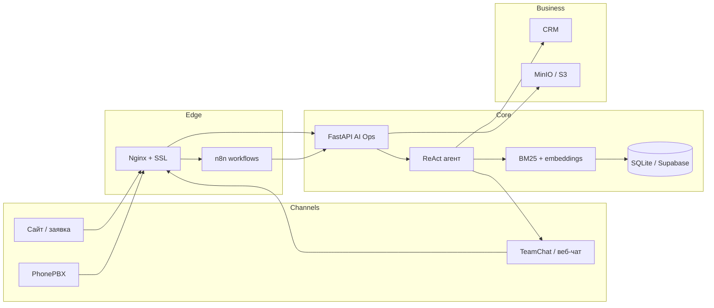

# Архитектура OpsForge

## Контуры

| Контур | Назначение |
| --- | --- |
| Lite | Только FastAPI + SQLite. Демо на ноутбуке за минуту. |
| Full | Docker: API, n8n, MinIO, Nginx. Показ «как в проде». |
| Live | Те же адаптеры, но с токенами CRM / TeamChat / OpenAI / Claude. |

## Почему два пути (n8n и API)

n8n удобен менеджеру автоматизаций: webhook, ветвления, расписание. Тяжёлая логика (RAG, квалификация, ReAct) живёт в API — её проще тестировать, версионировать и объяснять. n8n вызывает API, а не дублирует промпты.

## Адаптеры

Клиенты CRM, TeamChat, PhonePBX, S3 пишут события в `integration_events`. Без ключей работают mock-режимом: пайплайн всё равно «доезжает» до устойчивого результата, и это видно в UI.
